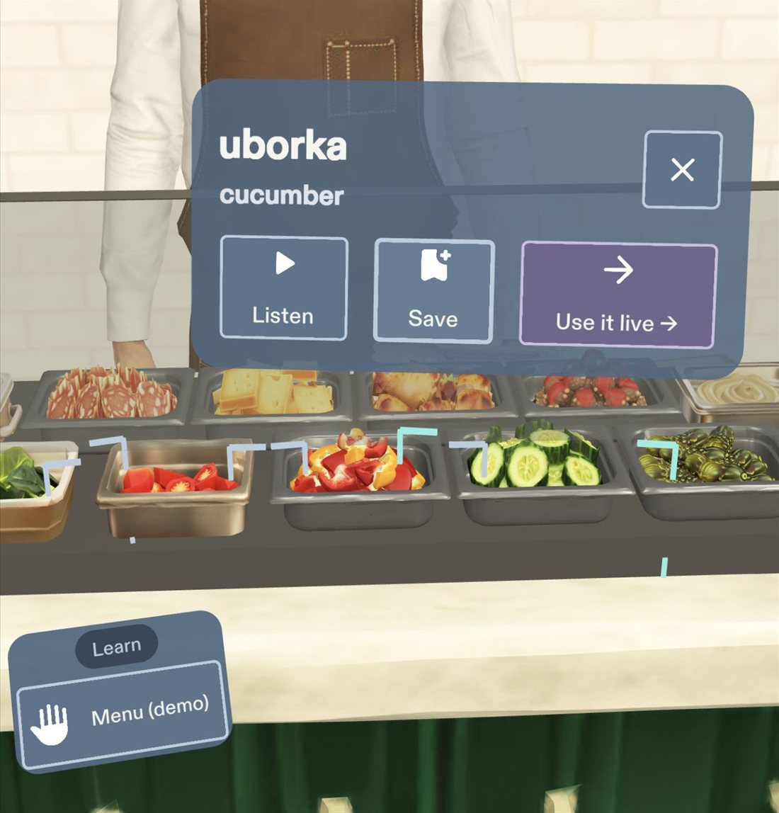
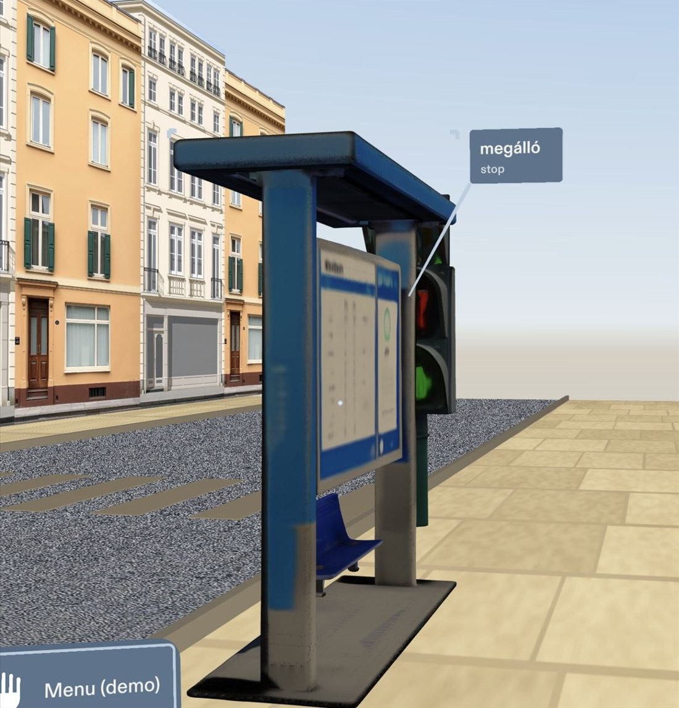
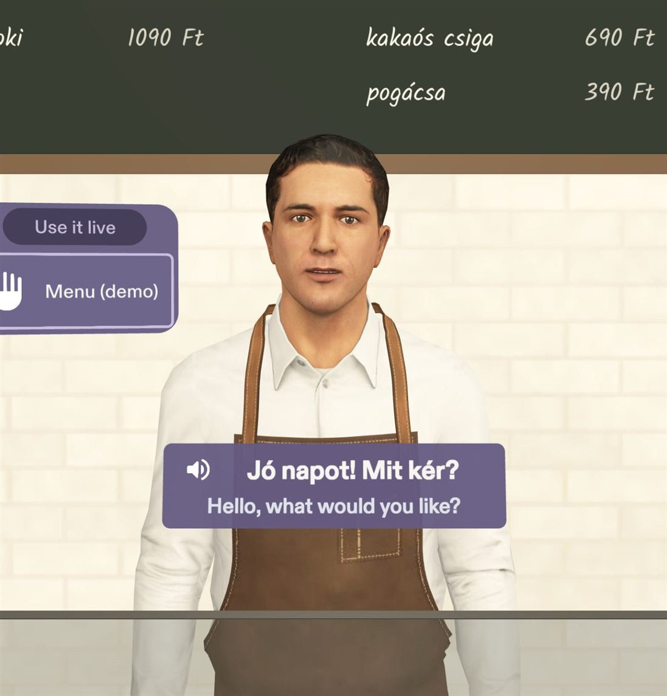
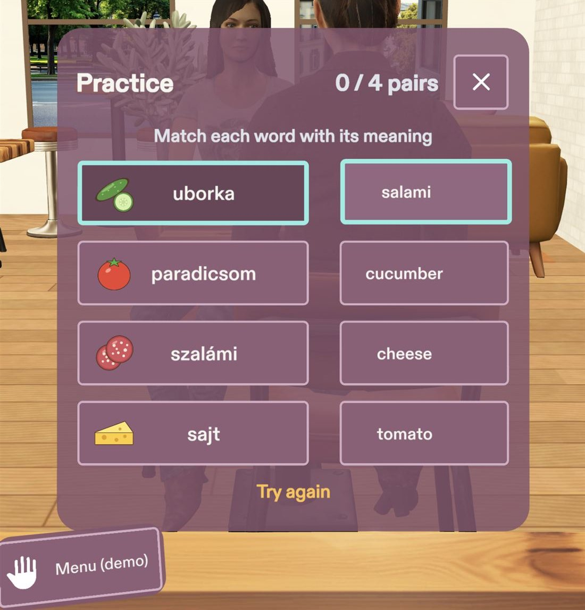
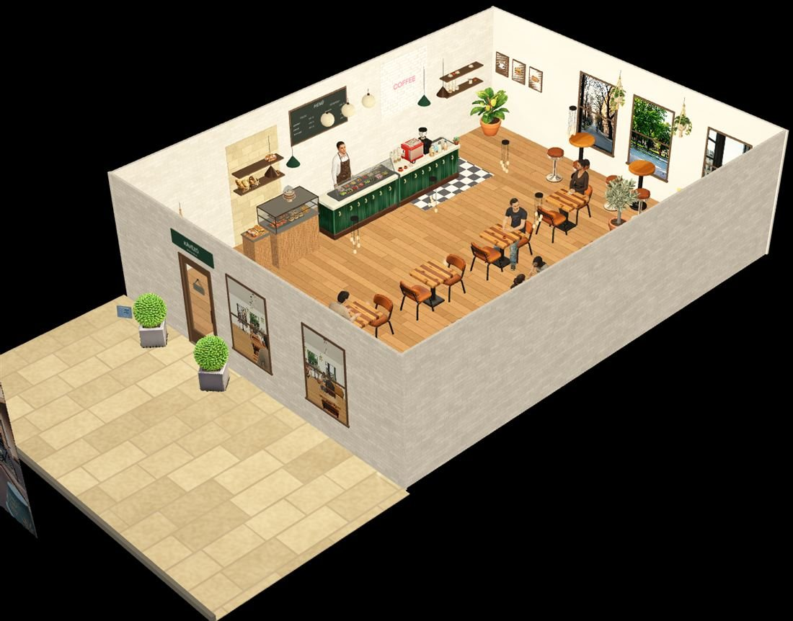

# Word by Word

**Learn Hungarian words where you use them.** Word by Word is a Lens for Snap Spectacles that puts the
Hungarian word on the real thing you are looking at, lets you hear it, save it and use it in a sentence
straight away, then practise it while you wait for your coffee.

The demo takes place in a Budapest bakery-café. Point at the olives and you see *olívabogyó · olives*.
Tap, and you hear it. Save it, and a minute later, when the barista asks *"Mit kér bele?"* ("What would you
like in it?"), the sentence you need is ready in front of you. Sit down, and the words you collected
become a short matching game.

> **About the café in the preview.** On real glasses the café, the barista and the guests would be real
> life. The 3D café in this project exists only so the experience can be shown in Lens Studio's preview.
> The product is the learning layer on top of it: the labels, cards, phrase help and practice.

---

## Why on glasses

On a phone you would look down, type or photograph the item, and break the conversation with the person in
front of you. On glasses:

- **The word is on the thing.** Labels and cards sit next to the real object, so the word links to what
  you see.
- **Your eyes stay up.** The barista's words show as a subtitle next to him, and the sentence you are
  about to say sits on the counter between you.
- **Your hands stay free.** A small pinch selects. No waving, no typing.

The idea behind it is vocabulary-first learning, the way children learn: many words linked to real things
and their sound, with grammar arriving through example sentences and real exchanges. It was inspired by
the Hungarian *Napszótár* books (ten everyday words a day), Krashen's comprehensible input and Willis's
lexical syllabus.

## What you can do

### Arrive
You start on the pavement outside the café. A small "Café detected (demo)" note stands in for location
recognition, and the app suggests what to do here: **Learn**, **Practice** or **Use it live**. Nothing
starts by itself.

Before you go in, the street and park around you still answer to pointing: the tram stop, the post office
across the road, the fountain in the park. These are words you saved on earlier outings, so the street
doubles as a quick review.

### Learn
- Three or four things in view get soft corner brackets, so you know what has a word.
- **Point** at something and its Hungarian and English name appears beside it, silently.
- **Pinch** and a calm word card opens with the word and its meaning, and plays the pronunciation.
  **Listen** replays it, **Save** keeps it, **Use it live →** takes it to the counter.
- 36 café words: ingredients on the sandwich counter, pastries, drinks, the menu board, the door's
  *NYITVA / ZÁRVA* sign and more. All are voiced by a Hungarian neural voice.

### Use it live: real-life conversation help
Use it live does not order for you. You order out loud, from a real person; the glasses only help.

1. **Prepare your sentence** while you queue. Point at ingredients and tap **Use this word** to build one
   reusable sentence: *"Kérek szalámit és paradicsomot a szendvicsembe."* ("I'd like salami and tomato in
   my sandwich."). One tap switches to leaving something out: *"Savanyú uborka nélkül, kérem."*
   **Listen** plays it.
2. **Walk up to the counter.** When you face the barista he greets you. His words appear as a subtitle,
   Hungarian with English underneath.
3. **"You could say".** Each reply is offered as a suggestion you can hear first, then say yourself. The
   microphone notices when you have spoken (in the preview, a **Said it** button stands in).
4. **Your table number.** When he asks *"Hányas asztalnál ül?"*, the reply *"A … asztalnál ülök."* waits
   with a gap. Glance at your table's number and the glasses read it (*8 = nyolc*) and complete the
   sentence.

### Practice
At your table, open the menu and choose **Practice**: four Hungarian words with pictures and their four
English meanings, shuffled. Match the pairs; each correct match plays the word. Today's words come first,
and words from earlier outings fill up the set.

### Saved words
One step at a time: first choose how to look at them (**By category**, **By date added**, **A to Z**),
then the category or time range, then the words. Tap any word to hear it.

### The menu
On Specs, raising an open hand opens the menu next to your palm. In the preview a small
**✋ Menu (demo)** button stands in for the gesture.

---

## The café (the demo stand-in)

A spacious Budapest bakery-café built at real scale (centimetres):

- **Counters.** A pastry case and a green-tiled sandwich counter with 15 ingredients.
- **Coffee bar and walls.** A coffee station, a chalk menu board, tables with number cards, and a small
  street and park outside.
- **People.** The barista and the seated guests are rigged
  [Microsoft Rocketbox](https://github.com/microsoft/Microsoft-Rocketbox) avatars (MIT). The barista
  breathes, blinks, keeps eye contact, moves his mouth while he speaks and nods when you answer.

## Tech

| | |
|---|---|
| Platform | Snap Spectacles, Lens Studio 5.23 |
| Language | TypeScript (`BaseScriptComponent` components) |
| Interaction | Spectacles Interaction Kit (hand ray, pinch, raised-hand menu), Spectacles UI Kit (panels, buttons, flex layout) |
| Voice | 147 pre-made Hungarian clips (Microsoft neural voices: Noémi for the learner, Tamás for the barista), generated by `agent/tts/make_hu_voice.py`; a native speaker can replace any clip with a recording under the same name |
| Speaking | an on-device voice-activity detector (`WbwVoiceActivity.ts`) notices when the learner has spoken; no speech is sent anywhere |
| Tests | LEAF integration tests that drive the real SIK interactions in the preview |

### How the code is organised

Everything lives in `Assets/Scripts/`. Each file starts with a header saying what it owns and what it must
not do.

| Area | Files |
|---|---|
| Orchestration | `WbwMain.ts` (start-up, arrival, menu, mode switching), `WbwSession.ts` (saved words, mode) |
| Modes | `WbwLearnController.ts`, `WbwOrderController.ts` (Use it live), `WbwPracticeController.ts` |
| Pointing | `WbwPointing.ts` (the single hover arbiter, pointer reach), `WbwNameLabelUI.ts` (labels beside objects) |
| Sentences | `WbwPhraseHelperModel.ts` (Hungarian forms: *uborka → uborkát*, "és", "nélkül"), `WbwPhraseHelperUI.ts`, `WbwPhraseChoicesUI.ts` |
| Views | `WbwWordCardUI.ts`, `WbwWordListUI.ts`, `WbwPracticeBoardUI.ts`, `WbwHudUI.ts`, `WbwModeMenuUI.ts`, `WbwSuggestionUI.ts`, `WbwSpeakPromptUI.ts`, `WbwServerCaptionUI.ts`, `WbwSharedUI.ts` (type scale, panels, buttons) |
| Content | `WbwVocab.ts` (words, phrases, server lines, tables), `WbwAudioBank.ts` / `WbwAudioController.ts` |
| The café | `WbwCafeBuilder.ts`, `WbwServerCharacter.ts`, `WbwHumanRig.ts`, `WbwDiner.ts`, `WbwDoor.ts`, `WbwSignageUI.ts` |

## Run it

1. Install **Lens Studio 5.23** or newer.
2. Clone this repository and open `Word_by_Word_SPECS_Hackhaton.esproj`.
3. In the Preview panel, choose the **Spectacles** device. For a clean view, pick the
   `PreviewStudio/Plain Studio` backdrop (a black studio, so only the Lens is drawn).
4. Press Start on the setup panel and walk forward with the preview controls (WASD and the mouse).
   Hover to point, click to pinch.
5. To try it on Specs, pair your Spectacles in Lens Studio and send the Lens to the device.

### Tests

Open the **LEAF** panel in Lens Studio and run a scenario. Each one matches a done criterion in the design
brief:

| Scenario | Checks |
|---|---|
| `DC1_ModeMenu` | menu, mode switching, saved words kept, the step-by-step saved-words viewer |
| `DC2_Learn` | brackets, silent hover labels, word card, listen, save |
| `DC3_OrderingAtCounter` | preparing the sentence, the barista noticing you, every reply up to the table question |
| `DC4_TableNumber` | reading a table number by looking, the matching reply, the end of the conversation |
| `DC5_Practice` | the matching game at a table |
| `DC6_Entrance` | arrival outside, the door, NYITVA / ZÁRVA |
| `DC7_OutsideWords` | street and park words outside, pointer reach |
| `TOUR_Story` | the whole demo story, from arrival to practice |
| `SHOTS_*` | scripted camera tours used for the screenshots |

## Project documents

- [`devpost/design-brief.md`](devpost/design-brief.md): what the product is, the learner's rules, the
  layout, and the done criteria.
- [`devpost/build-log.md`](devpost/build-log.md): the build history, every problem met and how it was
  solved, and the open items.
- [`devpost/development-timeline/`](devpost/development-timeline/): dated screenshots of every stage
  ([`devpost/timeline/index.html`](devpost/timeline/index.html) shows them as a visual timeline).
- [`devpost/audio-recording-list.md`](devpost/audio-recording-list.md): every voice clip and its file name.

## Credits and licences

- People: [Microsoft Rocketbox](https://github.com/microsoft/Microsoft-Rocketbox) avatars and motion clips
  (MIT).
- Chalk lettering: [Kalam](https://fonts.google.com/specimen/Kalam) (SIL Open Font License 1.1).
- Icons: [Google Material Symbols](https://fonts.google.com/icons) (Apache 2.0).
- The outside street's models and textures were generated with Lens Studio's built-in generators; the
  lawn, sky and shop signs were drawn by our own scripts.

Details are in [`licenses/README.md`](licenses/README.md).
